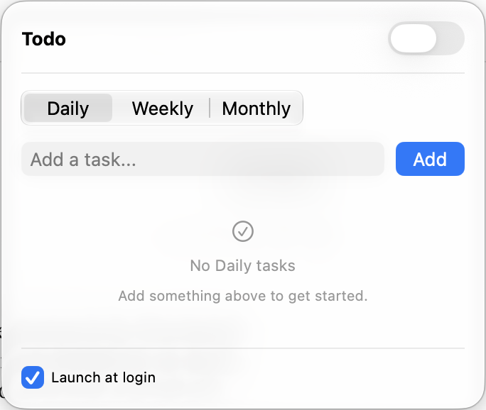
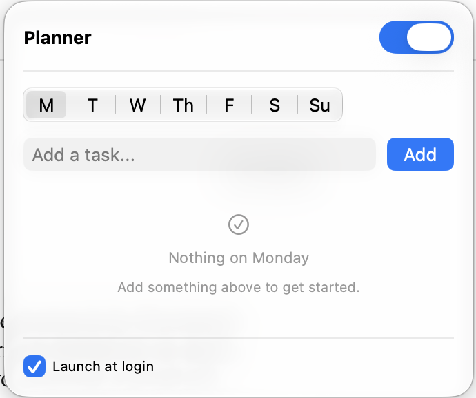

# Todo Widget

A macOS menu bar todo app built with SwiftUI. Keeps daily, weekly, and monthly task lists accessible from the top menu bar, with local persistence via UserDefaults.

<p>
  
  
</p>

## Features

- **Menu bar app** — lives in the macOS menu bar for quick access
- **Multiple lists** — switch between daily, weekly, and monthly views
- **Weekly planner** — a separate list for each day of the week
- **Due dates** — add dates to weekly and monthly tasks and see a D-day countdown
- **Local persistence** — tasks are saved automatically on your Mac
- **Launch at login** — optional, set from the widget

## Tech Stack

- Swift 6 / SwiftUI
- macOS 13+
- Swift Package Manager

## Install

Paste this into Terminal (requires macOS 13 or later):

```
curl -fsSL https://raw.githubusercontent.com/andrewcjh27/Todo-Widget/main/scripts/install.sh | bash
```

This downloads the latest release into your Applications folder and opens it. You can [read the script](scripts/install.sh) first.

Todo Widget is free and isn't notarized by Apple, so installing from the [Releases](https://github.com/andrewcjh27/Todo-Widget/releases) page instead may show a macOS security warning. To turn on launch at login, tick the checkbox at the bottom of the widget.

## How to use

1. Click the checklist icon in your menu bar to open the widget.
2. Pick **Daily**, **Weekly**, or **Monthly**.
3. Type a task and press Return, or click **Add**.
4. Click the circle next to a task to mark it done, and click it again to undo.
5. Click a task's name to rename it, or click the trash icon to delete it.
6. In Weekly or Monthly, click the calendar icon to add a due date. The task then shows a countdown, such as `D-3`.
7. Turn on the switch in the top right to open the planner, then pick a day to plan that day's tasks.
8. Tick **Launch at login** if you want the app to start with your Mac.

Some ways to use it:

- **Daily:** today's tasks, cleared as you finish them
- **Weekly:** what needs to get done this week, with due dates for deadlines
- **Monthly:** longer-term goals and upcoming deadlines
- **Planner:** a plan for each day, such as classes on Monday and errands on Saturday

## Uninstall

1. Untick **Launch at login** in the widget.
2. Run `pkill -x TodoWidget` in Terminal to quit the app.
3. Delete `TodoWidget.app` from your Applications folder.

## Build from source

Requires Xcode 26 or later.

```
scripts/build-app.sh 1.0.0
open dist/TodoWidget.app
```

To run it during development:

```
DEVELOPER_DIR=/Applications/Xcode.app/Contents/Developer \
swift run --scratch-path .build/scratch
```

## Publishing a release

Pushing a version tag builds the app and publishes it to GitHub Releases:

```
git tag v1.0.0
git push origin v1.0.0
```

## License

[MIT](LICENSE)
